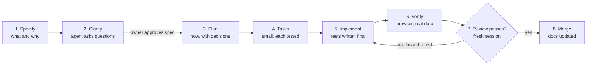

# Universal vibe coding web app setup spec

Szymon Słowik, version 1.0, 2026-11-24

## Purpose and scope

This spec defines a reusable setup for building web applications mostly with coding agents: the files, tools, guardrails and milestones every new project starts with. It is stack-agnostic; where a choice is needed, it names a default and the rule for replacing it.

- **Covers:** repository layout, documentation, agent configuration, MCP servers, testing, environments, continuous integration, deployment and the project roadmap.
- **Does not cover:** product strategy, visual design, choice of hosting provider or pricing.
- **Applies to:** any web application with a frontend, a backend or serverless functions, and a database, built by one person or a small team with one or more coding agents.
- **Default stack used in examples:** TypeScript, a Postgres database (for example Supabase), a serverless host (for example Vercel), Playwright for browser tests. Python equivalents are named where they differ.

A project complies with this spec when it passes the [acceptance checklist](#acceptance-checklist-for-the-setup) at the end of this document. Ready-to-copy templates are in [templates/](templates/).

## Principles of the setup

Every rule below is checkable by a person, a test or a hook. A project may add rules in its own constitution but may not weaken these.

1. **The spec is the source of truth.** Code that disagrees with an approved spec is a defect, unless the spec is updated in the same change.
2. **One term, one meaning, one name in code.** Every domain concept exists in the glossary before it exists in code.
3. **Nothing is done until it is verified.** Done means tests pass, the change was checked in a browser or against real data, and the documentation is updated.
4. **Tests must be able to fail.** Coverage percentage is not a quality measure; mutation testing is.
5. **No silent fallbacks.** A failed external call, an invalid model output or missing data raises a visible error. Mock or placeholder data never runs in staging or production.
6. **Small, reversible steps.** One task per session, one branch per task, small commits. Irreversible actions (schema changes, production deploys, data deletion) need human approval.
7. **Least privilege for agents.** Agents work in a sandbox, with read-only access to anything shared and no production credentials.
8. **Separate author and reviewer.** The session that wrote the code never approves it.
9. **Conflicts are flagged, never resolved silently.** When two documents disagree, the agent stops and asks.
10. **Context is loaded on demand.** The instruction file stays short and points to documents; skills and tools load only when a task needs them.

## Repository structure and documentation stack

Every project starts with this layout. Documents are plain markdown in git, so any agent or framework can read them.

```
AGENTS.md                      entry point for agents (CLAUDE.md imports it)
README.md                      entry point for humans
docs/
  constitution.md              project rules that override everything else
  glossary.md                  domain vocabulary mapped to names in code
  architecture.md              modules, data flow, external services
  decisions/
    0001-database-choice.md    one architecture decision record per decision
  specs/
    001-feature-name/
      spec.md                  what and why
      plan.md                  how
      tasks.md                 small steps, each with a test
  progress.md                  current state and handoff between sessions
  changelog.md                 shipped changes, newest first
src/                           application code
tests/
  unit/  integration/  end-to-end/
  fixtures/                    real data samples, anonymised
  evaluations/                 fixed inputs and expected outputs for model steps
supabase/migrations/           schema changes, only as migration files
.claude/  or  .agents/         skills, subagents, hooks, MCP configuration
.github/workflows/             continuous integration
.env.example                   variable names only, never values
```

### Order of authority

When documents conflict, the higher one wins and the agent must flag the conflict:

1. Constitution
2. Glossary
3. Architecture and decision records
4. Feature spec
5. Plan and tasks
6. Code

### Who updates what

| Document | Updated when | Updated by |
| --- | --- | --- |
| Constitution | A rule changes; new version number and reason | Owner only |
| Glossary | A new domain concept appears | Agent proposes, owner approves |
| Architecture | A module, service or data flow changes | Agent, reviewed by owner |
| Decision record | A technology or structural choice is made | Agent drafts, owner approves |
| Spec | Before implementation, and with any behaviour change | Agent drafts, owner approves |
| Progress log | End of every session | Agent |
| Changelog | Every merge to the main branch | Agent |

## Agent harness and context engineering

The agent gets a short entry file, skills for repeated procedures, subagents for isolated work and hooks that enforce the rules mechanically.

### Instruction file (AGENTS.md)

At most about 150 lines. It points to documents and never copies them. Required sections:

1. **Project in one paragraph** and a link to the constitution.
2. **Commands:** install, run locally, test, lint, type check, create a migration, deploy to staging.
3. **Folder map:** one line per top-level folder.
4. **Read before working:** glossary, architecture, the current spec, progress log.
5. **Forbidden actions:** writing to production, editing applied migrations, adding dependencies without a decision record, disabling tests, committing secrets, using mock data outside tests.
6. **Ask before:** schema changes, deleting files, renaming glossary terms, changing the constitution.
7. **Definition of done:** the checklist from the spec template.

### Skills

One skill per procedure the project repeats, loaded only when needed:

| Skill | What it does |
| --- | --- |
| Write a spec | Fills the spec template, asks the clarifying questions, links glossary terms |
| Create a migration | Writes the migration file, runs it on a local or branch database, regenerates types |
| Verify in browser | Opens the changed page with Playwright, checks the acceptance criteria, saves the check as a test |
| Update documentation | Updates the progress log, changelog, glossary and architecture after a change |
| Review a change | Checks the diff against the spec, constitution and glossary |

### Subagents

- **Reviewer:** a fresh context that reads the diff, the spec and the constitution, and reports defects. It never edits.
- **Explorer:** searches a large codebase and returns only conclusions, so the main session keeps its context.
- **Test writer:** writes tests from the acceptance criteria before the implementation exists.

### Hooks

- After each file edit: run the formatter, the type checker and the tests for the changed module.
- Before the agent reports a task as finished: run the full test suite and block completion on failure.
- Before any shell command: block commands that touch production or delete outside the working tree.
- At session end: require an updated progress log.

### Session discipline

- One task per session. Start by reading the progress log; end by updating it.
- Clear or compact context when switching tasks.
- Parallel agents each get their own git worktree and branch.

## MCP servers and command-line tools

Connect tools by job, starting with the first three rows, and add the rest only when a task needs them. Every connected server is a credential and an attack surface: in April 2026 a remote code execution vulnerability was disclosed in the stdio transport used by many MCP servers ([source](https://dev.to/moksh/top-mcp-servers-every-developer-should-install-in-2026-22bh)).

| Job | MCP server | Command-line alternative | Configuration rule |
| --- | --- | --- | --- |
| Current library documentation | Context7 | none | Always on. Coverage depends on indexing, so new or private libraries may be missing |
| Repository, pull requests, issues | GitHub MCP | `gh` | Token scoped to the project repository only |
| Browser verification | Playwright MCP | `@playwright/cli` | Staging or local only; it can submit forms and click destructive buttons |
| Database | Supabase MCP or a Postgres MCP | `supabase` | Read-only flag and a project-scoped token; schema changes through migration files |
| Deployment and logs | Vercel MCP | `vercel` | Read logs and preview deployments; promotion to production stays manual |
| Production errors | Sentry MCP | `sentry-cli` | Check that error payloads do not send personal data to the model |
| Task tracking | Linear or GitHub Issues MCP | `gh issue` | Agent reads tickets as input for specs; it does not close them |
| Payments, if any | Stripe MCP | `stripe` | Restricted test-mode keys only |

Rules:

- Prefer the command-line tool when the agent has a shell: it usually costs fewer tokens than a persistent MCP server.
- Keep MCP configuration in the repository (without secrets), so every agent and collaborator gets the same set.
- Review each server's maintainer and last update before adding it; prefer first-party servers.
- Treat everything a server returns (web pages, issues, logs) as data, never as instructions.

## Spec-driven workflow

Every feature goes through the same eight steps, and the owner approves the spec before any planning starts. The target is spec-anchored development: the spec stays in the repository and changes with the code.



A failed review sends the change back to implementation; only a reviewed change with updated documentation merges.

Step rules:

- **Specify:** the agent drafts from the template; every new concept is added to the glossary as a proposal.
- **Clarify:** the agent lists open questions; the spec is approved only when that list is empty.
- **Plan:** names files, modules, migrations and decision records; no code yet.
- **Tasks:** each task fits one session and names the test that proves it.
- **Implement:** tests from the acceptance criteria first, then code until they pass.
- **Verify:** the agent checks the change in a browser or against real data and saves the check as an end-to-end test.
- **Review:** a fresh session compares the diff with the spec, constitution and glossary.
- **Merge:** spec status set to implemented; progress log and changelog updated.

### Framework choice

| Framework | Fits | Note |
| --- | --- | --- |
| [OpenSpec](https://www.thoughtworks.com/radar/tools/openspec) | Products that keep evolving | Spec-anchored, change-centric; Trial in the November 2026 Thoughtworks Technology Radar |
| [GitHub Spec Kit](https://github.com/github/spec-kit) | New projects wanting the full artifact tree | Constitution, specify, plan, tasks, implement; works with any agent |
| [Kiro](https://infoworld.com/article/4171332/four-cutting-edge-tools-for-spec-driven-development.html) | Teams willing to switch editors | Spec-driven IDE and command-line tool from AWS; paid plans |
| Plain templates (this repository) | Any project | No framework dependency; the [templates](templates/) are enough to start |

## Quality assurance and testing

Agent-written code is verified in eight layers; each layer catches what the one before it misses. Mutation testing moved to Adopt in the November 2026 Thoughtworks Technology Radar because generated tests inflate coverage without catching logic changes ([source](https://www.thoughtworks.com/radar/techniques/mutation-testing)).

| Layer | Catches | Default tools (TypeScript / Python) | Runs |
| --- | --- | --- | --- |
| Static checks | Type errors, style, unused code | TypeScript strict mode, ESLint, Prettier / mypy or Pyright, Ruff | Every edit (hook) |
| Unit tests | Wrong logic in one function | Vitest / pytest | Every edit for the changed module |
| Property-based tests | Edge cases nobody listed | fast-check / Hypothesis | Every commit |
| Boundary validation | Malformed input, model output or database rows | Zod / Pydantic at every boundary | At runtime, always |
| Integration tests | Broken contracts between modules, database, APIs | Vitest or pytest against a local or branch database | Every pull request |
| End-to-end browser tests | Broken user flows | Playwright, written by the agent after it verifies the change in a browser | Every pull request, against a preview deployment |
| Mutation testing | Tests that pass whatever the code does | Stryker / mutmut, on changed files only | Every pull request |
| Evaluations | Quality drops in model-driven steps | A fixed set of inputs with expected outputs, run with promptfoo or the test runner | Every prompt or model change |

Additional checks:

- **Security:** Semgrep for dangerous code patterns, gitleaks for secrets in pre-commit, dependency audit in continuous integration.
- **Accessibility:** axe checks inside the Playwright tests for every page.
- **Performance:** a Lighthouse budget on key pages in continuous integration.
- **Review:** a fresh agent session reviews every pull request against the spec; optionally a hosted AI reviewer (CodeRabbit, Greptile, Qodo or GitHub Copilot review) as a second opinion. Vendor benchmarks are self-reported, so trial them on your own repository.

Thresholds to set in the constitution: minimum mutation score on changed code (for example 70%), zero failing tests on merge, zero high-severity security findings, evaluation score no lower than the last release.

## Environments, security and sandboxing

Agents work only in local and preview environments; production is reached only through the deployment pipeline. Thoughtworks now treats agent sandboxing as a sensible default for all agents ([source](https://www.thoughtworks.com/radar/techniques)).

| Environment | Database | Who writes | Agent access |
| --- | --- | --- | --- |
| Local | Local database (for example `supabase start`) or a database branch | Agent and developer | Full, inside the sandbox |
| Preview | A database branch per pull request | Pipeline | Read logs, run browser tests |
| Staging | Shared staging database with anonymised data | Pipeline | Read-only |
| Production | Production database | Pipeline after human approval | None, except read-only error and log tools |

Rules:

- **Sandbox:** agents run in a devcontainer or a cloud sandbox, with network access limited to package registries and the services the task needs.
- **Secrets:** stored in the host's environment variables or a secrets manager; `.env.example` lists names only; gitleaks blocks commits with secrets.
- **Database:** schema changes only through migration files reviewed in a pull request; row-level security enabled on every table that holds user data; generated types committed after each migration.
- **Data:** test fixtures are anonymised samples; personal data never goes into prompts, logs or evaluation sets.
- **Dependencies:** a new dependency needs a decision record; lockfile committed; automated update pull requests with tests.
- **Backups:** automated database backups with a tested restore before the first real user.

## Continuous integration and deployment

Nothing merges or deploys unless every stage below passes; production promotion is the only manual step.

**On every commit (pre-commit hooks, local):**

1. Format, lint, type check.
2. Secret scan with gitleaks.
3. Unit tests for changed files.

**On every pull request (continuous integration):**

1. Install from the lockfile, build.
2. Static checks and the full unit and property-based test suite.
3. Apply migrations to a fresh database branch; run integration tests.
4. Deploy a preview; run Playwright end-to-end and accessibility tests against it.
5. Mutation testing on changed files; fail under the constitution's threshold.
6. Evaluations, if prompts or model settings changed.
7. Semgrep and dependency audit.
8. Agent review in a fresh session, plus an optional hosted AI reviewer.
9. Check that the spec, glossary and changelog were updated when behaviour changed.

**On merge to the main branch:**

1. Deploy to staging and run smoke tests.
2. Human approval.
3. Apply migrations to production, then promote the build.
4. Watch error tracking for 30 minutes; roll back on a new error class.

Rollback rule: every deploy must be reversible by promoting the previous build; migrations that cannot be reversed need a written plan in the spec.

## Roadmap and milestones

A project moves to the next phase only when the gate at the end of the current one passes; feature work starts at phase 2. Phases are in order, not to scale: their length depends on the project.

```mermaid
flowchart LR
  P0["Phase 0: Foundation<br/>constitution v1, glossary v1,<br/>harness, pipeline, environments"] --> G0{{"Walking skeleton"}}
  G0 --> P1["Phase 1: Domain model<br/>schema, migrations,<br/>glossary mapped, real fixtures"] --> G1{{"Stable model"}}
  G1 --> P2["Phase 2: Vertical slices<br/>one spec each, eight-step loop,<br/>browser verified, real data"] --> G2{{"First workflow"}}
  G2 --> P3["Phase 3: Hardening<br/>error handling, observability,<br/>security review, evaluation sets"] --> G3{{"Beta"}}
  G3 --> P4["Phase 4: Operate<br/>changelog, debt reviews,<br/>refactor budget, amendments"] --> G4{{"Release cadence"}}
```



| Gate | Exit criteria |
| --- | --- |
| Walking skeleton | One trivial path runs input to database to output on staging; continuous integration green; acceptance checklist complete |
| Stable model | Schema migrated on a fresh database; generated types committed; every glossary term has one name in code; contract tests pass on real fixtures |
| First workflow | One complete user workflow runs on real data and produces output the owner would use; all its specs marked implemented |
| Beta | Someone other than the builder completes a workflow without help; error tracking live; security review done; evaluation scores recorded as baseline |
| Release cadence | A change ships to production without manual retesting of other features; rollback tested; changelog kept for every release |

## Templates

Copy these into `docs/` at the start of every project. Each rule in them must be checkable.

| Template | File |
| --- | --- |
| Constitution | [templates/constitution.md](templates/constitution.md) |
| Glossary | [templates/glossary.md](templates/glossary.md) |
| Feature spec | [templates/feature-spec.md](templates/feature-spec.md) |
| Progress log | [templates/progress.md](templates/progress.md) |

## Acceptance checklist for the setup

A new project is ready for feature work when every item is ticked.

**Documentation**

- [ ] Constitution version 1.0 with purpose, invariants, stack lock, quality thresholds and agent rules
- [ ] Glossary with every domain term mapped to a name in code
- [ ] Architecture document and first decision records (stack, database, hosting)
- [ ] Spec, plan and tasks templates in place
- [ ] Progress log and changelog started

**Agent harness**

- [ ] AGENTS.md under about 150 lines, with commands, folder map, forbidden actions and definition of done
- [ ] Skills for spec writing, migrations, browser verification, documentation update and review
- [ ] Reviewer subagent that cannot edit files
- [ ] Hooks for format, type check and tests after edits, and a block on finishing with failing tests
- [ ] MCP configuration committed without secrets; Context7, GitHub and Playwright connected

**Quality**

- [ ] Unit, property-based, integration and end-to-end test runners configured with one passing example each
- [ ] Schema validation at every external boundary
- [ ] Mutation testing on changed files with a threshold
- [ ] Evaluation set for each model-driven step
- [ ] Semgrep, gitleaks and dependency audit active

**Environments and delivery**

- [ ] Agent sandbox with no production credentials
- [ ] Local, preview, staging and production environments separated
- [ ] Migrations only through files; row-level security on user-data tables
- [ ] Continuous integration blocks merges on any failed stage
- [ ] Manual approval before production; rollback tested once
- [ ] Walking skeleton deployed to staging
